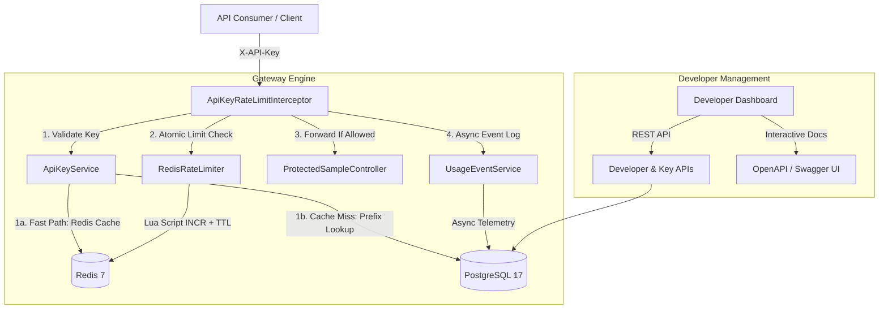

# Gatekeeper

> **A portfolio-grade, developer-focused API key lifecycle management and atomic rate-limiting platform built with Spring Boot, PostgreSQL, and Redis.**

[](https://github.com/savit0r/gatekeeper/actions/workflows/ci.yml)
[](https://adoptium.net/)
[](https://spring.io/projects/spring-boot)
[](https://www.postgresql.org/)
[](https://redis.io/)
[]()

---

## Architecture Overview

Gatekeeper is engineered as a **modular monolith** following package-by-feature boundaries:



### Core Modules
* **`identity`**: Developer account registration, profile management, and password hashing.
* **`apikey`**: Cryptographic key generation (256-bit `SecureRandom` entropy), prefix candidate lookup, constant-time SHA-256 validation, and sub-millisecond Redis key caching with instant cache eviction on revocation/rotation.
* **`plans`**: Rate-limit tiers (`Starter`, `Pro`, `Enterprise`) specifying requests per time window.
* **`gateway`**: HTTP request interception, rate-limit headers (`X-RateLimit-*`), atomic Redis enforcement, and `HTTP 429 Too Many Requests` responses.
* **`usage`**: Asynchronous request outcome telemetry and aggregated analytics.
* **`observability`**: Spring Boot Actuator health, liveness/readiness probes, and Micrometer metrics.

---

## Key Engineering Highlights

1. **Atomic Rate Limiting via Redis Lua Script**
   - Counter increment, initial window TTL setting, and quota evaluation happen inside a **single atomic Lua script execution**, preventing race conditions under high concurrency.
   - Configurable outage resilience: supports both **fail-closed** (default) and **fail-open** policies via `gatekeeper.ratelimit.fail-open`.

2. **Cryptographic Key Security**
   - Format: `gk_live_<8_hex_prefix>_<64_hex_secret>`.
   - Only the SHA-256 hash is persisted in PostgreSQL; raw keys can never be recovered from the database.
   - Comparison is performed using `MessageDigest.isEqual` to eliminate timing attacks.

3. **Asynchronous Telemetry**
   - Audit events are emitted asynchronously via `@Async` and Spring task execution, ensuring logging never impacts consumer response latency.

4. **Strict Schema Evolution**
   - Database migrations are strictly managed via **Flyway** with Hibernate `ddl-auto=validate`.

---

## Quickstart

### Prerequisites
- **Java 21**
- **Docker Desktop & Docker Compose**

### 1. Start Infrastructure
```bash
docker compose up -d
```
This spins up:
- **PostgreSQL 17** on port `5432`
- **Redis 7 (Alpine)** on port `6379`

### 2. Run Application
```bash
./mvnw spring-boot:run
```

The application will start on `http://localhost:8080`.

### 3. Interactive OpenAPI / Swagger UI
Open your browser to explore and execute API requests:
```
http://localhost:8080/swagger-ui.html
```

---

## End-to-End Demo Walkthrough

### 1. Register Developer
```bash
curl -X POST http://localhost:8080/api/v1/developers/register \
  -H "Content-Type: application/json" \
  -d '{
    "email": "developer@example.com",
    "password": "strongPassword123"
  }'
```
*Save the returned `id` as `DEVELOPER_ID`.*

---

### 2. List Usage Plans
```bash
curl http://localhost:8080/api/v1/plans
```
Response includes default seeded plans (`Starter` - 60 req/min, `Pro` - 1000 req/min).

---

### 3. Create an API Key
```bash
curl -X POST http://localhost:8080/api/v1/keys \
  -H "X-Developer-Id: <DEVELOPER_ID>" \
  -H "Content-Type: application/json" \
  -d '{
    "name": "Production Key",
    "planId": "00000000-0000-0000-0000-000000000001"
  }'
```
*Save the returned `rawKey` (e.g., `gk_live_...`). This is the only time it will ever be shown.*

---

### 4. Access Protected API Endpoint
```bash
curl -i http://localhost:8080/api/v1/protected/hello \
  -H "X-API-Key: <RAW_API_KEY>"
```
**Response Headers:**
```http
HTTP/1.1 200 OK
X-RateLimit-Limit: 60
X-RateLimit-Remaining: 59
X-RateLimit-Reset: 60
Content-Type: application/json
```

---

### 5. Rate Limit Exhaustion (HTTP 429)
When the limit for the current window is reached:
```http
HTTP/1.1 429 Too Many Requests
X-RateLimit-Limit: 60
X-RateLimit-Remaining: 0
X-RateLimit-Reset: 42
Retry-After: 42
Content-Type: application/json

{
  "timestamp": "2026-10-31T11:00:00Z",
  "status": 429,
  "error": "Too Many Requests",
  "message": "Rate limit exceeded. Try again in 42 seconds.",
  "limit": 60,
  "remaining": 0,
  "resetSeconds": 42
}
```

---

### 6. Inspect Usage Analytics
```bash
curl http://localhost:8080/api/v1/analytics/keys/<KEY_ID>/summary \
  -H "X-Developer-Id: <DEVELOPER_ID>"
```
**Response:**
```json
{
  "apiKeyId": "...",
  "keyName": "Production Key",
  "totalRequests": 61,
  "allowedRequests": 60,
  "rejectedRequests": 1,
  "averageLatencyMs": 8.4
}
```

---

### 7. Key Rotation
```bash
curl -X POST http://localhost:8080/api/v1/keys/<KEY_ID>/rotate \
  -H "X-Developer-Id: <DEVELOPER_ID>"
```
The old key is immediately revoked, and a fresh key is generated with the same plan configuration.

---

## Running Automated Tests

Run the full automated test suite (unit tests, web slice tests, and live Testcontainers/Docker integration tests):

```bash
./mvnw test
```
All **40 tests** run against real PostgreSQL and Redis instances.

---

## License

This project is licensed under the MIT License.
