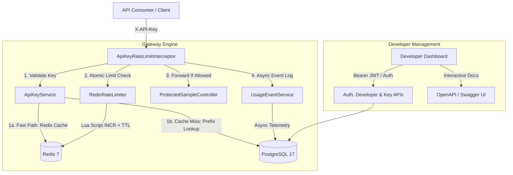

# Gatekeeper

> **A portfolio-grade, developer-focused API key lifecycle management and atomic rate-limiting platform built with Spring Boot, PostgreSQL, and Redis.**

[](https://github.com/savit0r/gatekeeper/actions/workflows/ci.yml)
[](https://adoptium.net/)
[](https://spring.io/projects/spring-boot)
[](https://www.postgresql.org/)
[](https://redis.io/)
[]()
[](http://localhost:8080/actuator/prometheus)
[](https://www.docker.com/)
[](https://openjdk.org/jeps/444)

---

## Architecture Overview

Gatekeeper is engineered as a **modular monolith** following package-by-feature boundaries:



### Core Modules
* **`identity`**: Developer account registration, profile management, password hashing, and stateless HMAC-SHA256 JWT authentication (`POST /api/v1/auth/login`).
* **`apikey`**: Cryptographic key generation (256-bit `SecureRandom` entropy), prefix candidate lookup, constant-time SHA-256 validation, and sub-millisecond Redis key caching with instant cache eviction on revocation/rotation.
* **`plans`**: Rate-limit tiers (`Starter`, `Pro`, `Enterprise`) specifying requests per time window.
* **`gateway`**: HTTP request interception, rate-limit headers (`X-RateLimit-*`), atomic Redis enforcement, and `HTTP 429 Too Many Requests` responses.
* **`usage`**: Asynchronous request outcome telemetry and aggregated analytics.
* **`observability`**: Spring Boot Actuator health, liveness/readiness probes, and Micrometer metrics.

---

## Key Engineering Highlights

1. **Atomic Rate Limiting via Redis Lua Script**
   - Counter increment, initial window TTL setting, and quota evaluation happen inside a **single atomic Lua script execution**, preventing race conditions under high concurrency.
   - Configurable outage resilience: supports both **fail-closed** (default) and **fail-open** policies via `gatekeeper.ratelimit.fail-open`.

2. **Cryptographic Key Security**
   - Format: `gk_live_<8_hex_prefix>_<64_hex_secret>`.
   - Only the SHA-256 hash is persisted in PostgreSQL; raw keys can never be recovered from the database.
   - Comparison is performed using `MessageDigest.isEqual` to eliminate timing attacks.

3. **Asynchronous Telemetry**
   - Audit events are emitted asynchronously via `@Async` and Spring task execution, ensuring logging never impacts consumer response latency.

4. **Strict Schema Evolution**
   - Database migrations are strictly managed via **Flyway** with Hibernate `ddl-auto=validate`.

---

## Quickstart

### Prerequisites
- **Docker Desktop & Docker Compose**
- **Java 21** (optional, only for local source compilation)

---

### Option A: One-Command Full Stack (Docker Compose)
Launch PostgreSQL 17, Redis 7, and Gatekeeper together in optimized multi-stage containers:

```bash
docker compose up --build -d
```
* **Gatekeeper API**: `http://localhost:8080`
* **Swagger UI / Interactive Docs**: `http://localhost:8080/swagger-ui.html`
* **Prometheus Metrics**: `http://localhost:8080/actuator/prometheus`

---

### Option B: Local Development
```bash
# 1. Start backing services
docker compose up -d postgres redis

# 2. Run Spring Boot locally
./mvnw spring-boot:run
```

---

## End-to-End Demo Walkthrough

### 1. Register Developer
```bash
curl -X POST http://localhost:8080/api/v1/developers/register \
  -H "Content-Type: application/json" \
  -d '{
    "email": "developer@example.com",
    "password": "strongPassword123"
  }'
```

---

### 2. Authenticate & Obtain JWT Bearer Token
```bash
curl -X POST http://localhost:8080/api/v1/auth/login \
  -H "Content-Type: application/json" \
  -d '{
    "email": "developer@example.com",
    "password": "strongPassword123"
  }'
```
*Save the returned `token` as `JWT_TOKEN`.*

---

### 3. List Usage Plans
```bash
curl http://localhost:8080/api/v1/plans
```
Response includes default seeded plans (`Starter` - 60 req/min, `Pro` - 1000 req/min, `Enterprise` - 10000 req/min).

---

### 4. Create an API Key (Authenticated via Bearer Token)
```bash
curl -X POST http://localhost:8080/api/v1/keys \
  -H "Authorization: Bearer <JWT_TOKEN>" \
  -H "Content-Type: application/json" \
  -d '{
    "name": "Production Key",
    "planId": "00000000-0000-0000-0000-000000000001"
  }'
```
*Save the returned `rawKey` (e.g., `gk_live_...`). This is the only time it will ever be shown.*

---

### 4. Access Protected API Endpoint
```bash
curl -i http://localhost:8080/api/v1/protected/hello \
  -H "X-API-Key: <RAW_API_KEY>"
```
**Response Headers:**
```http
HTTP/1.1 200 OK
X-RateLimit-Limit: 60
X-RateLimit-Remaining: 59
X-RateLimit-Reset: 60
Content-Type: application/json
```

---

### 5. Rate Limit Exhaustion (HTTP 429)
When the limit for the current window is reached:
```http
HTTP/1.1 429 Too Many Requests
X-RateLimit-Limit: 60
X-RateLimit-Remaining: 0
X-RateLimit-Reset: 42
Retry-After: 42
Content-Type: application/json

{
  "timestamp": "2026-10-31T11:00:00Z",
  "status": 429,
  "error": "Too Many Requests",
  "message": "Rate limit exceeded. Try again in 42 seconds.",
  "limit": 60,
  "remaining": 0,
  "resetSeconds": 42
}
```

---

### 6. Inspect Usage Analytics
```bash
curl http://localhost:8080/api/v1/analytics/keys/<KEY_ID>/summary \
  -H "X-Developer-Id: <DEVELOPER_ID>"
```
**Response:**
```json
{
  "apiKeyId": "...",
  "keyName": "Production Key",
  "totalRequests": 61,
  "allowedRequests": 60,
  "rejectedRequests": 1,
  "averageLatencyMs": 8.4
}
```

---

### 7. Key Rotation
```bash
curl -X POST http://localhost:8080/api/v1/keys/<KEY_ID>/rotate \
  -H "X-Developer-Id: <DEVELOPER_ID>"
```
The old key is immediately revoked, and a fresh key is generated with the same plan configuration.

---

### 8. Prometheus Metrics Scrape
Scrape real-time operational metrics across rate limiting, key lifecycle, sub-millisecond Redis caching, and gateway latency:
```bash
curl -s http://localhost:8080/actuator/prometheus
```
**Exported Series:**
* `gatekeeper_ratelimit_requests_total{status="allowed|rejected", plan="..."}`: Rate-limiting quota enforcement decisions.
* `gatekeeper_keycache_lookups_total{result="hit|miss"}`: Redis hot-path key cache efficiency.
* `gatekeeper_key_lifecycle_total{action="created|revoked|rotated"}`: Key management lifecycle operations.
* `gatekeeper_auth_logins_total{result="success|failure"}`: Developer authentication attempts.
* `gatekeeper_gateway_latency_seconds`: Nanosecond-precision gateway processing latency timer.

---

### 9. High-Concurrency Stress Benchmark (Virtual Threads)
Gatekeeper leverages **Java 21 Virtual Threads (Project Loom)** (`spring.threads.virtual.enabled=true`) for non-blocking I/O throughput across incoming HTTP connections, sub-millisecond Redis key caching, and atomic Lua script rate evaluation.

Run the automated 1,000-request benchmark across 50 concurrent virtual threads:
```bash
./benchmark/run_benchmark.sh
```

**Measured Production Performance (Local Benchmark on Apple Silicon M-series):**
```
Target URL:         http://localhost:8080/api/v1/protected/hello
Usage Plan:         Enterprise (10000 req / 60s)
Total Requests:     1,000
Concurrency Level:  50 virtual client threads
-----------------------------------------------------------------
Throughput:         435.4 requests/second
HTTP 200 (Allowed): 1,000 (100%)
Network Errors:     0
Median (p50):       103 ms
p90 Latency:        178 ms
p99 Latency:        290 ms
Cache Hit Rate:     99.0% (sub-millisecond Redis Hash hot path)
```

Alternatively, run with [Grafana k6](https://k6.io/):
```bash
k6 run benchmark/k6-load-test.js
```

---

## Running Automated Tests

Run the full automated test suite (unit tests, web slice tests, and live Docker integration tests):

```bash
./mvnw test
```
All **64 tests** run against real PostgreSQL and Redis instances.

---

## License

This project is licensed under the MIT License.
